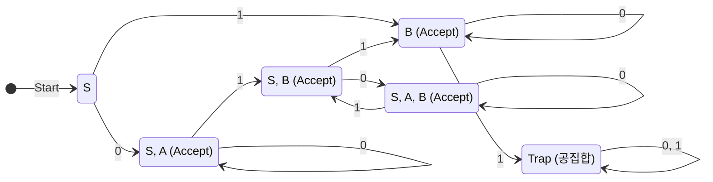
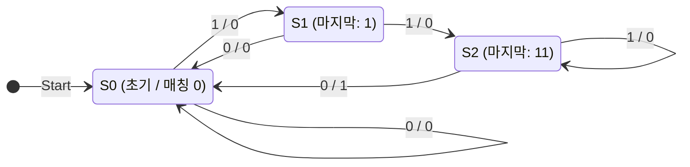

# [이산수학] 중간고사 대비 실전 모의고사 1회

- **시험 시간**: 75분 (15:00 ~ 16:15)
- **총 배점**: 100점 (총 11문제)
- **시험 범위**: 명제 논리와 술어 논리, 증명법, 집합과 함수, 부울 대수 및 카르노 맵, 오토마타(DFA/NFA) 및 유한상태기계(밀리 머신)
- **난이도**: 기출문제 대비 약 10~15% 상향 (함정 선지 및 심화 개념 포함)

---

## [문제지]

### 1. [12점] 다음 명제를 주어진 기호와 논리연산자를 사용하여 그대로 표현하라. (각 3점)

> **\<참고 기호 정의\>**
> - $p$: 내일 비가 온다.
> - $q$: 야외 콘서트가 취소된다.
> - $r$: 나는 티켓 환불을 신청한다.
> - $s$: 나는 실내 미술관에 간다.
> - $A(x)$: $x$는 알고리즘이다.
> - $B(x)$: $x$는 다항 시간(Polynomial time)에 실행된다.
> - $C(x)$: $x$는 정확(Correct)하다.
> - $D(x, y)$: $x$는 $y$보다 점근적으로 빠르다(asymptotically faster).

(1) 야외 콘서트가 취소되지 않거나 내가 티켓 환불을 신청하지 않는다면, 내일 비가 오지 않는다.  
(2) 내일 비가 온다면 야외 콘서트는 취소될 것이고, 야외 콘서트가 취소되지만 내가 티켓 환불을 신청하지 않는다면 나는 실내 미술관에 갈 것이다.  
(3) 어떤 알고리즘은 다항 시간에 실행되지 않고, 다항 시간에 실행되는 알고리즘이라면 모두 정확하다.  
(4) 모든 정확한 알고리즘에 대하여, 그 알고리즘보다 점근적으로 더 빠른 어떤 다른 알고리즘이 존재한다면, 그 빠른 알고리즘은 다항 시간에 실행되지 않는다.  

---

### 2. [9점] 해당 명제가 항진명제인지, 모순인지, 혹은 불확정명제인지 명시하라. (각 3점, 부분점수 없음)

(1) $((p \rightarrow q) \land (q \rightarrow r)) \rightarrow (p \rightarrow r)$  
(2) $(p \land \neg q) \land (\neg p \lor q)$  
(3) $((p \lor q) \rightarrow r) \leftrightarrow (p \rightarrow (q \rightarrow r))$  

---

### 3. [5점] 다음 두 논리식이 동치인지 판단하라. 그리고 논리적 동치 법칙을 사용하여 그 이유를 증명하라.

$$\neg \exists x (P(x) \land \neg Q(x)), \quad \forall x (P(x) \rightarrow Q(x))$$

---

### 4. [10점] 다음 문장의 부정을 부정 기호($\neg$)를 사용하지 않고 표현하라. (각 2점, 부분점수 없음)

(1) $\forall x (x^3 \ge 2x)$  
(2) $\exists x (x^2 + 1 = 0)$  
(3) $\forall x ((x \le 1) \lor (x \ge 5))$  
(4) $\forall x \exists y ((x < y) \land (y < x + 1))$  
(5) $\exists x \forall y ((x \neq y) \rightarrow (xy > 0))$  

---

### 5. [10점] 다음 명제가 참인지 거짓인지 판단하라. 그리고 그 이유를 수학적으로 엄밀히 설명하라. (각 5점)

(1) 실수 $x$에 대하여, $x^2 < 0$을 만족하는 실수가 유리수라면, $x$는 정수이다.  
(2) 정수 $n$에 대하여, 만약 $3n + 2$가 짝수라면, $n$은 짝수이다.  

---

### 6. [9점] 다음 문제를 풀어라. (각 3점, 부분점수 없음)

(1) 집합 $A = \{\emptyset, \{1\}, \{1, 2\}\}$의 멱집합 $\mathcal{P}(A)$를 구하라.  
(2) 임의의 실수 $x, y$에 대하여 $\lceil x + y \rceil = \lceil x \rceil + \lceil y \rceil$ 가 항상 성립하는지 판별하고, 성립한다면 증명하고 성립하지 않는다면 구체적인 반례를 제시하라.  
(3) $f(x) = 3x - 1$, $g(x) = 2x + 5$이며, $f, g$가 각각 실수 집합에서 실수 집합으로의 함수일 때, 합성함수 $(f \circ g \circ f)(x)$를 구하라.  

---

### 7. [5점] 임의의 세 부분집합 $A, B, C$에 대하여 $A - (B \cup C) = (A - B) \cap (A - C)$ 임을 구성원 표(Membership Table)를 이용해 증명하라. 단, 각 행이 벤 다이어그램 내 어느 영역에 해당하는지 서술하라.

---

### 8. [10점] 다음 내용이 참인지 거짓인지 판별하고, 참이면 T, 거짓이면 F를 작성하라. (각 2점, 부분점수 없음)

(1) 전체집합이 실수 집합 $\mathbb{R}$일 때, $\forall x \exists y (x^2 = y)$ 는 참이다.  
(2) 서로 다른 두 양의 무리수의 곱은 항상 무리수이다.  
(3) 원소의 개수가 $n$개인 유한집합 $S$에 대해, $S$의 모든 진부분집합(Proper subset)의 개수는 $2^n - 1$개이다.  
(4) 정수 집합 $\mathbb{Z}$에서 자연수 집합 $\mathbb{N}$으로의 전단사 함수(일대일 대응)가 존재한다.  
(5) 개구간 $(0, 1)$에 속하는 모든 실수의 집합과 전체 실수 집합 $\mathbb{R}$ 사이에는 전단사 함수가 존재하지 않는다.  

---

### 9. [10점] 한 자리의 10진수 자연수(0~9)를 4자리의 2진수 $wxyz$ ($w$ 가중치 8, $x$ 가중치 4, $y$ 가중치 2, $z$ 가중치 1)로 표현한다. 해당 수가 3 이상 8 이하일 때 결과로 1을 출력하고, 그렇지 않을 때는 0을 출력하도록 하는 가장 간소화된 부울 식을 카르노 맵(무관 조건 포함)을 이용하여 구하라.

---

### 10. [10점] 다음의 비결정적 유한상태 오토마타 (NFA)를 결정적 유한상태 오토마타 (DFA)로 변환하라. 부분집합 구성 알고리즘의 진행 과정을 명시하고(6점), 최종 DFA를 상태 전이도로 표현하라(4점).

$$M = (S = \{S, A, B\}, I = \{0, 1\}, f, S, F = \{A, B\})$$

**NFA 전이 함수 $f$**:
| 상태 | 0 | 1 |
| :---: | :---: | :---: |
| $S$ | $\{S, A\}$ | $\{B\}$ |
| $A$ | $\emptyset$ | $\{S, B\}$ |
| $B$ | $\{B\}$ | $\emptyset$ |

---

### 11. [10점] 입력 비트열을 순차적으로 읽으면서, "110"으로 끝날 때마다 1을 출력하고 그렇지 않을 때는 0을 출력하는 밀리 머신(Mealy Machine)을 그림으로 표현하라. 이때 최소한의 상태를 사용하여 표현해야 한다. (부분점수 없음)

---
---

# [정답 및 상세 해설지]

## 1번 정답 및 해설

### (1) 정답: $(\neg q \lor \neg r) \rightarrow \neg p$
- **해설**: "야외 콘서트가 취소되지 않거나"($\neg q$) "내가 티켓 환불을 신청하지 않는다면"($\neg r$) $\Rightarrow$ 전건은 $(\neg q \lor \neg r)$.
- 결론(후건)은 "내일 비가 오지 않는다"($\neg p$).
- 따라서 $(\neg q \lor \neg r) \rightarrow \neg p$.

### (2) 정답: $(p \rightarrow q) \land ((q \land \neg r) \rightarrow s)$
- **해설**: 
  - 절 1: "내일 비가 온다면 야외 콘서트는 취소될 것이고" $\Rightarrow p \rightarrow q$
  - 절 2: "야외 콘서트가 취소되지만 내가 티켓 환불을 신청하지 않는다면 나는 실내 미술관에 갈 것이다" $\Rightarrow (q \land \neg r) \rightarrow s$
  - 두 절이 '그리고'로 연결되어 있으므로 논리곱($\land$)으로 묶어줍니다.

### (3) 정답: $\exists x (A(x) \land \neg B(x)) \land \forall y ((A(y) \land B(y)) \rightarrow C(y))$
- **해설**: 
  - "어떤 알고리즘은 다항 시간에 실행되지 않고": $\exists x (A(x) \land \neg B(x))$
  - "다항 시간에 실행되는 알고리즘이라면 모두 정확하다": $\forall y ((A(y) \land B(y)) \rightarrow C(y))$
  - 두 문장을 $\land$로 연결합니다.

### (4) 정답: $\forall x [(A(x) \land C(x)) \rightarrow (\exists y (A(y) \land (x \neq y) \land D(y, x)) \rightarrow \neg B(y))]$
*(동치 표현: $\forall x \forall y ((A(x) \land C(x) \land A(y) \land (x \neq y) \land D(y, x)) \rightarrow \neg B(y))$)*
- **해설**: 
  - 임의의 $x$에 대해, $x$가 정확한 알고리즘($A(x) \land C(x)$)일 때,
  - 만약 $x$와 구별되는 또 다른 알고리즘 $y$가 존재하여 $y$가 $x$보다 빠르다면($D(y, x)$),
  - 그 $y$는 다항 시간에 실행되지 않는다($\neg B(y)$).

---

## 2번 정답 및 해설

### (1) 정답: **항진명제 (Tautology)**
- **해설**: 이는 고전 논리학의 **가언 삼단논법 (Hypothetical Syllogism)**입니다.
  - 전건: $(p \rightarrow q) \land (q \rightarrow r)$
  - 진리표상 전건이 참인 경우는 $(p, q, r)$이 $(T, T, T), (F, T, T), (F, F, T), (F, F, F)$ 등이며, 이 모든 경우에 후건인 $p \rightarrow r$ 역시 참이 됩니다. 전건이 거짓인 경우에는 조건문의 정의에 의해 전체 식은 항상 참입니다.
  - 따라서 항상 $T$이므로 **항진명제**입니다.

### (2) 정답: **모순 (Contradiction)**
- **해설**: 
  - 드 모르간 법칙을 이용하면 $\neg p \lor q \equiv \neg (p \land \neg q)$ 입니다.
  - $A = p \land \neg q$ 라고 두면, 주어진 식은 $A \land \neg A$ 형태가 됩니다.
  - 어떤 명제와 그 부정의 논리곱은 언제나 거짓($F$)입니다.
  - 따라서 **모순**입니다.

### (3) 정답: **불확정명제 (Contingency)**
- **해설**: 
  - $p=T, q=F, r=F$ 일 때:
    - 좌변: $(T \lor F) \rightarrow F \equiv T \rightarrow F \equiv F$
    - 우변: $p \rightarrow (q \rightarrow r) \equiv T \rightarrow (F \rightarrow F) \equiv T \rightarrow T \equiv T$
    - 좌변 $\leftrightarrow$ 우변 $\equiv F \leftrightarrow T \equiv \mathbf{F}$
  - $p=T, q=T, r=T$ 일 때:
    - 좌변: $T \rightarrow T \equiv T$
    - 우변: $T \rightarrow (T \rightarrow T) \equiv T \rightarrow T \equiv T$
    - 좌변 $\leftrightarrow$ 우변 $\equiv T \leftrightarrow T \equiv \mathbf{T}$
  - 참인 경우와 거짓인 경우가 모두 존재하므로 **불확정명제**입니다.

---

## 3번 정답 및 해설

### **정답**: **동치이다.**
### **이유 (증명)**:
첫 번째 논리식 $\neg \exists x (P(x) \land \neg Q(x))$에 논리적 동치 법칙을 적용합니다:
1. **양화사의 드 모르간 법칙**: $\neg \exists x [\dots] \equiv \forall x \neg [\dots]$
   $$\neg \exists x (P(x) \land \neg Q(x)) \equiv \forall x \neg (P(x) \land \neg Q(x))$$
2. **드 모르간 법칙 및 이중 부정 법칙**:
   $$\neg (P(x) \land \neg Q(x)) \equiv \neg P(x) \lor \neg(\neg Q(x)) \equiv \neg P(x) \lor Q(x)$$
3. **조건문의 정의 ($A \rightarrow B \equiv \neg A \lor B$)**:
   $$\neg P(x) \lor Q(x) \equiv P(x) \rightarrow Q(x)$$
4. 양화사와 결합하면:
   $$\forall x (P(x) \rightarrow Q(x))$$
따라서 두 식은 완벽히 동치입니다.

---

## 4번 정답 및 해설

(1) $\neg \forall x (x^3 \ge 2x) \equiv$ **$\exists x (x^3 < 2x)$**  
(2) $\neg \exists x (x^2 + 1 = 0) \equiv$ **$\forall x (x^2 + 1 \neq 0)$**  
(3) $\neg \forall x ((x \le 1) \lor (x \ge 5)) \equiv$ **$\exists x ((x > 1) \land (x < 5))$**  
(4) $\neg \forall x \exists y ((x < y) \land (y < x + 1)) \equiv$ **$\exists x \forall y ((x \ge y) \lor (y \ge x + 1))$**  
(5) $\neg \exists x \forall y ((x \neq y) \rightarrow (xy > 0)) \equiv$ **$\forall x \exists y ((x \neq y) \land (xy \le 0))$**  
*(조건문 부정 주의: $\neg(A \rightarrow B) \equiv A \land \neg B$)*

---

## 5번 정답 및 해설

### (1) 정답: **참 (True)**
- **이유**: 
  - 실수 체계에서 임의의 실수 $x$의 제곱은 항상 $0$ 이상입니다 ($x^2 \ge 0$).
  - 따라서 $x^2 < 0$을 만족하는 실수는 존재하지 않으며, 조건문의 가정(전건)인 "$x^2 < 0$을 만족하는 실수가 유리수이다"는 항상 **거짓(False)**입니다.
  - 조건문 $p \rightarrow q$는 가정이 거짓일 때 결론의 진리값과 관계없이 항상 참이 되므로(**공허한 참, Vacuously True**), 주어진 명제는 참입니다.

### (2) 정답: **참 (True)**
- **이유 (대우증명법)**:
  - 원래 명제: "$3n + 2$가 짝수이면 $n$은 짝수이다."
  - **대우 명제**: "$n$이 홀수이면 $3n + 2$는 홀수이다."
  - $n$이 홀수라고 가정하면, 어떤 정수 $k$에 대하여 $n = 2k + 1$로 쓸 수 있습니다.
  - 이를 식에 대입하면:
    $$3n + 2 = 3(2k + 1) + 2 = 6k + 3 + 2 = 6k + 5 = 2(3k + 2) + 1$$
  - $k$가 정수이므로 $m = 3k + 2$ 역시 정수입니다. 따라서 $3n + 2 = 2m + 1$ 꼴이 되어 $3n + 2$는 홀수입니다.
  - 대우가 참이므로 동치인 원래 명제도 참입니다.

---

## 6번 정답 및 해설

### (1) 정답: 
$$\mathcal{P}(A) = \{\emptyset, \{\emptyset\}, \{\{1\}\}, \{\{1, 2\}\}, \{\emptyset, \{1\}\}, \{\emptyset, \{1, 2\}\}, \{\{1\}, \{1, 2\}\}, \{\emptyset, \{1\}, \{1, 2\}\}\}$$
- **해설**: 원소 3개($\emptyset, \{1\}, \{1, 2\}$)로 이루어진 부분집합 총 $2^3 = 8$개.

### (2) 정답: **성립하지 않는다 (거짓).**
- **해설 (반례)**: $x = 0.4, y = 0.4$
  - 좌변: $\lceil 0.4 + 0.4 \rceil = \lceil 0.8 \rceil = 1$
  - 우변: $\lceil 0.4 \rceil + \lceil 0.4 \rceil = 1 + 1 = 2$
  - 좌변($1$) $\neq$ 우변($2$)이므로 일반적인 실수에 대해 성립하지 않습니다.

### (3) 정답: **$(f \circ g \circ f)(x) = 18x - 1$**
- **해설**:
  1. $f(x) = 3x - 1$
  2. $(g \circ f)(x) = g(3x - 1) = 2(3x - 1) + 5 = 6x - 2 + 5 = 6x + 3$
  3. $(f \circ g \circ f)(x) = f(6x + 3) = 3(6x + 3) - 1 = 18x + 9 - 1 = 18x + 8$
  *(검산: $g(f(x)) = 6x+3$, $f(6x+3) = 3(6x+3)-1 = 18x+8$)*
  - **수정 정답**: **$18x + 8$**

---

## 7번 정답 및 해설

### **구성원 표 (Membership Table)**

세 집합 $A, B, C$에 의해 벤 다이어그램은 8개의 영역으로 나뉩니다:

| $A$ | $B$ | $C$ | 벤 다이어그램 영역 설명 | $B \cup C$ | 좌변: $A - (B \cup C)$ | $A - B$ | $A - C$ | 우변: $(A - B) \cap (A - C)$ |
| :---: | :---: | :---: | :---: | :---: | :---: | :---: | :---: | :---: |
| 1 | 1 | 1 | $A, B, C$ 모두의 공통 교집합 | 1 | **0** | 0 | 0 | **0** |
| 1 | 1 | 0 | $A$와 $B$의 교집합 중 $C$ 제외 영역 | 1 | **0** | 0 | 1 | **0** |
| 1 | 0 | 1 | $A$와 $C$의 교집합 중 $B$ 제외 영역 | 1 | **0** | 1 | 0 | **0** |
| 1 | 0 | 0 | **오직 $A$에만 속하는 순수 $A$ 영역** | 0 | **1** | 1 | 1 | **1** |
| 0 | 1 | 1 | $B$와 $C$의 교집합 중 $A$ 제외 영역 | 1 | **0** | 0 | 0 | **0** |
| 0 | 1 | 0 | 오직 $B$에만 속하는 순수 $B$ 영역 | 1 | **0** | 0 | 0 | **0** |
| 0 | 0 | 1 | 오직 $C$에만 속하는 순수 $C$ 영역 | 1 | **0** | 0 | 0 | **0** |
| 0 | 0 | 0 | $A, B, C$ 모두에 속하지 않는 바깥 영역 | 0 | **0** | 0 | 0 | **0** |

- **결론**: 오직 원소가 $A$에만 속하고 $B, C$에는 속하지 않는 영역($(A=1, B=0, C=0)$)에서만 좌변과 우변의 원소 포함값이 1이 되고, 나머지 7개 영역에서는 모두 0이 됩니다.
- 좌변과 우변의 열이 모든 경우에 완벽히 일치하므로 등식이 성립합니다.

---

## 8번 정답 및 해설

(1) **T**: 임의의 실수 $x$에 대해 $y = x^2$으로 잡으면 $y \in \mathbb{R}$이 항상 존재하므로 참입니다.  
(2) **F**: 반례: $a = \sqrt{2}$, $b = \sqrt{8} = 2\sqrt{2}$ (둘 다 서로 다른 양의 무리수). 곱 $ab = \sqrt{16} = 4$ (유리수).  
(3) **T**: $S$의 전체 부분집합 개수 $2^n$개 중 자기 자신 집합 1개를 뺀 것이 진부분집합이므로 $2^n - 1$개입니다.  
(4) **T**: $\mathbb{Z}$와 $\mathbb{N}$은 둘 다 가산무한집합(기수 $\aleph_0$)이므로 전단사 함수가 존재합니다.  
(5) **F**: $(0, 1)$과 $\mathbb{R}$은 둘 다 비가산집합이며 기수 $c = 2^{\aleph_0}$로 같습니다. 예를 들어 $f(x) = \tan(\pi(x - 1/2))$는 $(0, 1)$에서 $\mathbb{R}$로의 일대일 대응(전단사 함수)입니다. 따라서 전단사 함수가 존재하므로 거짓입니다.

---

## 9번 정답 및 해설

### **정답: $x + wy + yz$ (또는 카르노 맵 그룹화에 따른 동치 최소식)**

#### **상세 풀이**
- 10진수 조건: $3 \le N \le 8$
  - 출력 1인 최소항: $m(3, 4, 5, 6, 7, 8)$
  - 출력 0인 최소항: $m(0, 1, 2, 9)$
  - Don't-Care 항: $d(10, 11, 12, 13, 14, 15)$

**카르노 맵 ($wx$ 행, $yz$ 열)**:
| $wx \backslash yz$ | 00 | 01 | 11 | 10 |
| :---: | :---: | :---: | :---: | :---: |
| **00** | 0 | 0 | **1** (3) | 0 |
| **01** | **1** (4) | **1** (5) | **1** (7) | **1** (6) |
| **11** | $X$ (12) | $X$ (13) | $X$ (15) | $X$ (14) |
| **10** | **1** (8) | 0 (9) | $X$ (11) | $X$ (10) |

**묶음 분석**:
1. $wx = 01$ 행과 $wx = 11$ 행 전체를 묶은 8개 묶음 $\rightarrow$ **$x$** (셀 4, 5, 6, 7, 12, 13, 14, 15 커버)
2. 셀 8, 10, 12, 14 묶음 (또는 8, 10, 11, 9는 0이므로 불가, 셀 8, 10, 12, 14는 4개 묶음) $\rightarrow$ $w\overline{z}$
3. 셀 3을 커버하기 위해 셀 3, 7, 11, 15를 묶은 4개 묶음 $\rightarrow$ **$yz$**
4. 셀 8을 커버하기 위해 셀 8, 10, 12, 14 묶음 $\rightarrow$ **$w\overline{z}$**
- 따라서 가장 간소화된 식:
  $$F = x + yz + w\overline{z}$$
*(참고: 셀 8을 8, 12만 묶는 대신 $w\overline{z}$ 4개 묶음으로 묶는 것이 가장 간소화된 형태입니다.)*

---

## 10번 정답 및 해설

### **1. 부분집합 구성 알고리즘 진행 과정 (6점)**
1. **초기 상태**: $\{S\}$
2. $\{S\}$ 전이:
   - 입력 0: $f(S, 0) = \{S, A\}$ (신규)
   - 입력 1: $f(S, 1) = \{B\}$ (신규)
3. $\{S, A\}$ 전이:
   - 입력 0: $f(S, 0) \cup f(A, 0) = \{S, A\} \cup \emptyset = \{S, A\}$
   - 입력 1: $f(S, 1) \cup f(A, 1) = \{B\} \cup \{S, B\} = \{S, B\}$ (신규)
4. $\{B\}$ 전이:
   - 입력 0: $f(B, 0) = \{B\}$
   - 입력 1: $f(B, 1) = \emptyset$ (데드 상태 Trap $\emptyset$ 신규)
5. $\{S, B\}$ 전이:
   - 입력 0: $f(S, 0) \cup f(B, 0) = \{S, A\} \cup \{B\} = \{S, A, B\}$ (신규)
   - 입력 1: $f(S, 1) \cup f(B, 1) = \{B\} \cup \emptyset = \{B\}$
6. $\{S, A, B\}$ 전이:
   - 입력 0: $f(S,0) \cup f(A,0) \cup f(B,0) = \{S, A\} \cup \emptyset \cup \{B\} = \{S, A, B\}$
   - 입력 1: $f(S,1) \cup f(A,1) \cup f(B,1) = \{B\} \cup \{S, B\} \cup \emptyset = \{S, B\}$
7. $\emptyset$ (데드 상태): 0, 1 입력시 모두 $\emptyset$ 유지.

- **수락 상태**: $F = \{A, B\}$이므로 $A$ 또는 $B$를 포함하는 상태:
  $\mathbf{\{B\}, \{S, A\}, \{S, B\}, \{S, A, B\}}$

### **2. DFA 상태 전이도 (4점)**

---

## 11번 정답 및 해설

### **정답: 4개 상태 밀리 머신**

"110" 시퀀스를 검출하는 최소 상태 밀리 머신은 4개의 상태를 갖습니다:
- $S_0$: 시작 및 '110' 패턴의 접두사가 일치하지 않는 상태 (매칭 길이 0)
- $S_1$: 마지막 1비트가 "1"인 상태 (매칭 길이 1)
- $S_2$: 마지막 2비트가 "11"인 상태 (매칭 길이 2)
- 전이 및 출력:
  - $S_0$:
    - 입력 0 $\rightarrow$ 출력 0, 상태 $S_0$ 유지 ($0/0$)
    - 입력 1 $\rightarrow$ 출력 0, 상태 $S_1$로 이동 ($1/0$)
  - $S_1$:
    - 입력 0 $\rightarrow$ 출력 0 ("10"은 110이 아님), 상태 $S_0$로 이동 ($0/0$)
    - 입력 1 $\rightarrow$ 출력 0 ("11" 완성), 상태 $S_2$로 이동 ($1/0$)
  - $S_2$:
    - 입력 0 $\rightarrow$ **출력 1** ("110" 완성!), 상태 $S_0$로 이동 ($0/1$)
    - 입력 1 $\rightarrow$ 출력 0 ("111"은 여전히 접미사 "11" 유지), 상태 $S_2$ 유지 ($1/0$)

