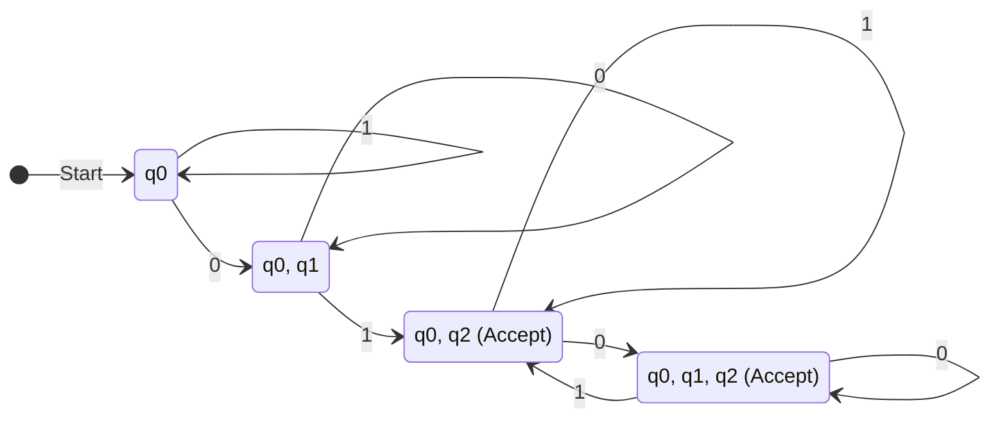
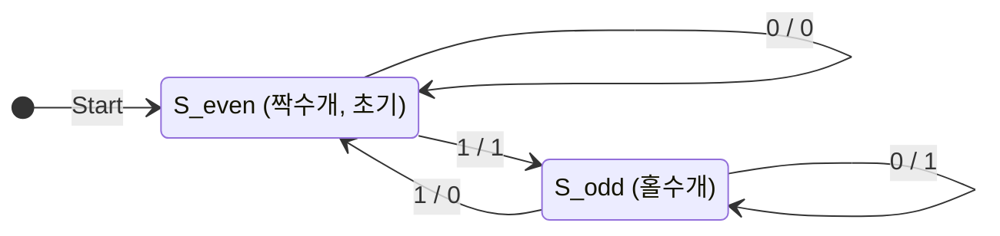

# [이산수학] 중간고사 대비 실전 모의고사 2회

- **시험 시간**: 75분 (15:00 ~ 16:15)
- **총 배점**: 100점 (총 11문제)
- **시험 범위**: 명제 논리와 술어 논리, 증명법, 집합과 함수, 부울 대수 및 카르노 맵, 오토마타(DFA/NFA) 및 유한상태기계(밀리 머신)
- **난이도**: 기출문제 대비 약 10~15% 상향 (동치 반례 제시 및 정수론적 증명 포함)

---

## [문제지]

### 1. [12점] 다음 명제를 주어진 기호와 논리연산자를 사용하여 그대로 표현하라. (각 3점)

> **\<참고 기호 정의\>**
> - $p$: 서버 트래픽이 급증한다.
> - $q$: 데이터베이스 응답이 지연된다.
> - $r$: 로드밸런서가 경고를 발생시킨다.
> - $s$: 시스템 관리자가 수동 복구 모드를 활성화한다.
> - $P(x)$: $x$는 프로세스다.
> - $Q(x)$: $x$는 교착 상태(Deadlock)에 빠져 있다.
> - $R(x)$: $x$는 임계 자원을 점유하고 있다.
> - $T(x, y)$: $x$는 $y$가 점유한 자원의 해제를 기다린다.

(1) 서버 트래픽이 급증하지 않는다면, 데이터베이스 응답이 지연되지 않거나 로드밸런서가 경고를 발생시키지 않는다.  
(2) 데이터베이스 응답이 지연된다면 서버 트래픽이 급증한 것이고, 로드밸런서가 경고를 발생시키는데도 관리자가 수동 복구 모드를 활성화하지 않는다면 서버 트래픽이 급증한 것이다.  
(3) 어떤 프로세스는 교착 상태에 빠져 있지 않고, 교착 상태에 빠진 프로세스라면 모두 임계 자원을 점유하고 있다.  
(4) 교착 상태에 빠져 있으면서 임계 자원을 점유하는 모든 프로세스는 항상 자신과 다른 어떤 교착 상태의 프로세스가 점유한 자원의 해제를 기다린다.  

---

### 2. [9점] 해당 명제가 항진명제인지, 모순인지, 혹은 불확정명제인지 명시하라. (각 3점, 부분점수 없음)

(1) $(p \land (p \rightarrow q)) \rightarrow q$  
(2) $(p \leftrightarrow q) \land (p \land \neg q)$  
(3) $(p \lor q) \rightarrow (p \land q)$  

---

### 3. [5점] 다음 두 논리식이 동치인지 판단하라. 만약 동치가 아니라면 동치가 성립하지 않음을 보일 수 있는 구체적인 반례(전체집합 정의역 및 각 술어의 해석)를 제시하고 그 이유를 설명하라.

$$\forall x (P(x) \rightarrow Q(x)), \quad (\forall x P(x)) \rightarrow (\forall x Q(x))$$

---

### 4. [10점] 다음 문장의 부정을 부정 기호($\neg$)를 사용하지 않고 표현하라. (각 2점, 부분점수 없음)

(1) $\exists x (x^2 - 4 < 0)$  
(2) $\forall x (2x + 1 \neq 5)$  
(3) $\exists x ((x > 0) \land (x \le 10))$  
(4) $\forall x \forall y ((x = y) \lor (x + y \neq 0))$  
(5) $\exists x \forall y ((x \le y) \rightarrow (x^2 \le y^2))$  

---

### 5. [10점] 다음 명제가 참인지 거짓인지 판단하라. 그리고 그 이유를 수학적으로 엄밀히 설명하라. (각 5점)

(1) 실수 $x$에 대하여, $x^2 + 1 \le 0$을 만족하는 실수가 무리수라면, $x > 100$이다.  
(2) 정수 $n$에 대하여, 만약 $n^2$이 3의 배수라면, $n$은 3의 배수이다.  

---

### 6. [9점] 다음 문제를 풀어라. (각 3점, 부분점수 없음)

(1) 집합 $A = \{\{a\}, b, \{a, b\}\}$의 멱집합 $\mathcal{P}(A)$를 구하라.  
(2) 정수가 아닌 임의의 실수 $x$에 대하여 $\lfloor x \rfloor + \lfloor -x \rfloor = 0$ 이 성립하는지 판별하고, 성립하지 않는다면 구체적인 반례를 들고 실제 올바른 값이 무엇인지 밝히시오.  
(3) $f(x) = 4x - 3$, $g(x) = \frac{1}{2}x + 1$이며, $f, g$가 각각 실수 집합에서 실수 집합으로의 함수일 때, 합성함수 $(f \circ g \circ g)(x)$를 구하라.  

---

### 7. [5점] 임의의 세 부분집합 $A, B, C$에 대하여 $A - (B \cap C) = (A - B) \cup (A - C)$ 임을 구성원 표(Membership Table)를 이용해 증명하라. 단, 각 행이 벤 다이어그램 내 어느 영역에 해당하는지 서술하라.

---

### 8. [10점] 다음 내용이 참인지 거짓인지 판별하고, 참이면 T, 거짓이면 F를 작성하라. (각 2점, 부분점수 없음)

(1) 전체집합이 실수 집합 $\mathbb{R}$일 때, $\forall x \forall y ((x > 0 \land y < 0) \rightarrow xy < 0)$ 는 참이다.  
(2) 임의의 0이 아닌 유리수와 임의의 무리수의 합은 항상 무리수이다.  
(3) 원소의 개수가 각각 $m, n$인 두 유한집합 $A, B$에 대하여, $A$에서 $B$로의 서로 다른 관계(Relation)의 총 개수는 $2^{mn}$개이다.  
(4) 양의 짝수 전체의 집합 $E = \{2, 4, 6, \dots\}$과 자연수 전체의 집합 $\mathbb{N}$의 기수(Cardinality)는 서로 다르다.  
(5) 닫힌 구간 $[0, 1]$에 속하는 모든 실수의 집합은 비가산 무한집합(Uncountable Set)이다.  

---

### 9. [10점] 한 자리의 10진수 자연수(0~9)를 4자리의 2진수 $wxyz$ ($w$ 가중치 8, $x$ 가중치 4, $y$ 가중치 2, $z$ 가중치 1)로 표현한다. 해당 수가 4 이하이거나 8 이상일 때 1을 출력하고, 5 이상 7 이하일 때 0을 출력하도록 하는 가장 간소화된 부울 식을 카르노 맵(무관 조건 포함)을 이용하여 구하라.

---

### 10. [10점] 다음의 비결정적 유한상태 오토마타 (NFA)를 결정적 유한상태 오토마타 (DFA)로 변환하라. 부분집합 구성 알고리즘의 진행 과정을 명시하고(6점), 최종 DFA를 상태 전이도로 표현하라(4점).

$$M = (S = \{q_0, q_1, q_2\}, I = \{0, 1\}, f, q_0, F = \{q_2\})$$

**NFA 전이 함수 $f$**:
| 상태 | 0 | 1 |
| :---: | :---: | :---: |
| $q_0$ | $\{q_0, q_1\}$ | $\{q_0\}$ |
| $q_1$ | $\emptyset$ | $\{q_2\}$ |
| $q_2$ | $\{q_2\}$ | $\{q_2\}$ |

---

### 11. [10점] 입력 비트열을 순차적으로 읽으면서, 지금까지 입력된 '1'의 누적 개수가 홀수 개일 때마다 1을 출력하고, 짝수 개(0개 포함)일 때마다 0을 출력하는 밀리 머신(Mealy Machine - 홀수 패리티 검출기)을 그림으로 표현하라. 이때 최소한의 상태를 사용하여 표현해야 한다. (부분점수 없음)

---
---

# [정답 및 상세 해설지]

## 1번 정답 및 해설

### (1) 정답: $\neg p \rightarrow (\neg q \lor \neg r)$
- **해설**: "서버 트래픽이 급증하지 않는다면"($\neg p$)이 전건입니다.
- 후건은 "데이터베이스 응답이 지연되지 않거나"($\neg q$) "로드밸런서가 경고를 발생시키지 않는다"($\neg r$) $\Rightarrow \neg q \lor \neg r$.
- 따라서 $\neg p \rightarrow (\neg q \lor \neg r)$.

### (2) 정답: $(q \rightarrow p) \land ((r \land \neg s) \rightarrow p)$
- **해설**:
  - 절 1: $q \rightarrow p$ ("응답 지연이면 트래픽 급증한 것")
  - 절 2: $(r \land \neg s) \rightarrow p$ ("경고 발생($r$)하는데 수동복구 안 하면($\neg s$) 트래픽 급증($p$)")
  - 두 절을 $\land$로 연결합니다.

### (3) 정답: $\exists x (P(x) \land \neg Q(x)) \land \forall y ((P(y) \land Q(y)) \rightarrow R(y))$
- **해설**: 
  - 어떤 프로세스는 교착 상태가 아님: $\exists x (P(x) \land \neg Q(x))$
  - 교착 상태인 프로세스는 모두 임계 자원을 점유: $\forall y ((P(y) \land Q(y)) \rightarrow R(y))$
  - 두 명제를 $\land$로 결합합니다.

### (4) 정답: $\forall x [(P(x) \land Q(x) \land R(x)) \rightarrow \exists y (P(y) \land Q(y) \land (x \neq y) \land T(x, y))]$
- **해설**: 
  - 임의의 $x$에 대해, $x$가 교착 상태이고 자원을 점유하는 프로세스라면 ($P(x) \land Q(x) \land R(x)$),
  - $x$와 다른 어떤 교착 상태 프로세스 $y$ ($P(y) \land Q(y) \land x \neq y$)가 존재하여, $x$가 $y$의 자원 해제를 기다린다($T(x, y)$).

---

## 2번 정답 및 해설

### (1) 정답: **항진명제 (Tautology)**
- **해설**: 추론 규칙 중 가장 기본인 **긍정 논법(Modus Ponens)**의 논리식 형태입니다.
  - 전건: $p \land (p \rightarrow q)$.
  - $p=T$이고 $p \rightarrow q = T$이면 반드시 $q=T$가 되어 후건 $q$가 참입니다.
  - 전건이 $F$이면 조건문의 정의에 의해 전체는 $T$입니다.
  - 따라서 항상 $T$이므로 **항진명제**입니다.

### (2) 정답: **모순 (Contradiction)**
- **해설**:
  - $p \leftrightarrow q$는 $p$와 $q$의 진리값이 같을 때만 참입니다.
  - 그런데 우측의 $p \land \neg q$는 $p=T, q=F$일 때만 참입니다.
  - 즉 두 조건은 동시에 만족될 수 없습니다 ($p=T, q=F$일 때 $p \leftrightarrow q$는 $F$).
  - 모든 진리값 조합에서 항상 $F$이므로 **모순**입니다.

### (3) 정답: **불확정명제 (Contingency)**
- **해설**:
  - $p=T, q=F$일 때:
    - 전건: $T \lor F \equiv T$
    - 후건: $T \land F \equiv F$
    - 전체식: $T \rightarrow F \equiv \mathbf{F}$
  - $p=T, q=T$일 때:
    - 전건: $T \lor T \equiv T$
    - 후건: $T \land T \equiv T$
    - 전체식: $T \rightarrow T \equiv \mathbf{T}$
  - 참과 거짓이 모두 가능하므로 **불확정명제**입니다.

---

## 3번 정답 및 해설

### **정답**: **동치가 아니다 (거짓).**
### **이유 및 반례**:
- **개념 분석**:
  - $\forall x (P(x) \rightarrow Q(x))$는 "모든 $x$에 대해 $P(x)$이면 $Q(x)$이다"라는 강한 조건입니다.
  - 반면 $(\forall x P(x)) \rightarrow (\forall x Q(x))$는 "만약 모든 $x$가 $P$를 만족한다면, 모든 $x$가 $Q$를 만족한다"는 문장으로, 모든 $x$가 $P$를 만족하지 않는 경우(즉 어떤 $x$에 대해 $P(x)$가 거짓인 경우) 전건이 거짓이 되어 우변은 **항상 참**이 됩니다!
- **구체적인 반례**:
  - **전체집합(정의역)**: 정수 집합 $\mathbb{Z}$
  - **술어 정의**:
    - $P(x)$: "$x$는 짝수이다"
    - $Q(x)$: "$x$는 4의 배수이다"
  - **진리값 평가**:
    - 좌변: $\forall x (P(x) \rightarrow Q(x))$
      - $x = 2$일 때 $P(2)$는 참이지만 $Q(2)$는 거짓이므로 $T \rightarrow F \equiv F$입니다. 따라서 좌변은 **거짓($F$)**입니다.
    - 우변: $(\forall x P(x)) \rightarrow (\forall x Q(x))$
      - 모든 정수가 짝수인 것은 아니므로 전건 $\forall x P(x)$는 거짓($F$)입니다.
      - 조건문에서 전건이 거짓이므로 우변 전체는 공허하게 **참($T$)**이 됩니다.
  - 따라서 좌변은 거짓($F$)인데 우변은 참($T$)이므로 두 식은 **동치가 아닙니다**.

---

## 4번 정답 및 해설

(1) $\neg \exists x (x^2 - 4 < 0) \equiv$ **$\forall x (x^2 - 4 \ge 0)$**  
(2) $\neg \forall x (2x + 1 \neq 5) \equiv$ **$\exists x (2x + 1 = 5)$**  
(3) $\neg \exists x ((x > 0) \land (x \le 10)) \equiv$ **$\forall x ((x \le 0) \lor (x > 10))$**  
(4) $\neg \forall x \forall y ((x = y) \lor (x + y \neq 0)) \equiv$ **$\exists x \exists y ((x \neq y) \land (x + y = 0))$**  
(5) $\neg \exists x \forall y ((x \le y) \rightarrow (x^2 \le y^2)) \equiv$ **$\forall x \exists y ((x \le y) \land (x^2 > y^2))$**  

---

## 5번 정답 및 해설

### (1) 정답: **참 (True)**
- **이유**:
  - 실수 $x$에 대하여 $x^2 \ge 0$이므로 $x^2 + 1 \ge 1 > 0$입니다.
  - 따라서 $x^2 + 1 \le 0$을 만족하는 실수는 존재하지 않으며, 가정 명제는 항상 **거짓(False)**입니다.
  - 조건문 $p \rightarrow q$에서 가정이 거짓이면 결론의 참/거짓과 상관없이 전체 명제는 항상 참이 됩니다(**공허한 참, Vacuous Truth**).

### (2) 정답: **참 (True)**
- **이유 (대우증명법)**:
  - 원래 명제: "$n^2$이 3의 배수이면 $n$은 3의 배수이다."
  - **대우 명제**: "$n$이 3의 배수가 아니면, $n^2$은 3의 배수가 아니다."
  - 정수 $n$이 3의 배수가 아니면, 어떤 정수 $k$에 대해 $n = 3k + 1$ 또는 $n = 3k + 2$로 나타낼 수 있습니다.
    - **경우 1**: $n = 3k + 1$
      $$n^2 = (3k + 1)^2 = 9k^2 + 6k + 1 = 3(3k^2 + 2k) + 1$$
      따라서 3으로 나눈 나머지가 1이므로 3의 배수가 아닙니다.
    - **경우 2**: $n = 3k + 2$
      $$n^2 = (3k + 2)^2 = 9k^2 + 12k + 4 = 3(3k^2 + 4k + 1) + 1$$
      마찬가지로 3으로 나눈 나머지가 1이므로 3의 배수가 아닙니다.
  - 두 경우 모두 $n^2$은 3의 배수가 아니므로 대우 명제가 참입니다. 따라서 원래 명제도 참입니다.

---

## 6번 정답 및 해설

### (1) 정답:
$$\mathcal{P}(A) = \{\emptyset, \{\{a\}\}, \{b\}, \{\{a, b\}\}, \{\{a\}, b\}, \{\{a\}, \{a, b\}\}, \{b, \{a, b\}\}, \{\{a\}, b, \{a, b\}\}\}$$
- **해설**: 원소 3개($\{a\}, b, \{a, b\}$)의 모든 부분집합 8개.

### (2) 정답: **성립하지 않는다 (반례 제시, 올바른 값은 $-1$).**
- **해설 (반례)**: $x = 2.3$
  - 좌변: $\lfloor 2.3 \rfloor + \lfloor -2.3 \rfloor = 2 + (-3) = -1 \neq 0$.
- **일반적 성질**: $x$가 정수가 아닐 때 항상 $\lfloor x \rfloor + \lfloor -x \rfloor = -1$입니다. (정수일 때만 0).

### (3) 정답: **$(f \circ g \circ g)(x) = x + 3$**
- **해설**:
  1. $g(x) = \frac{1}{2}x + 1$
  2. $(g \circ g)(x) = g\left(\frac{1}{2}x + 1\right) = \frac{1}{2}\left(\frac{1}{2}x + 1\right) + 1 = \frac{1}{4}x + \frac{1}{2} + 1 = \frac{1}{4}x + \frac{3}{2}$
  3. $(f \circ g \circ g)(x) = f\left(\frac{1}{4}x + \frac{3}{2}\right) = 4\left(\frac{1}{4}x + \frac{3}{2}\right) - 3 = (x + 6) - 3 = x + 3$.

---

## 7번 정답 및 해설

### **구성원 표 (Membership Table)**

| $A$ | $B$ | $C$ | 벤 다이어그램 영역 설명 | $B \cap C$ | 좌변: $A - (B \cap C)$ | $A - B$ | $A - C$ | 우변: $(A - B) \cup (A - C)$ |
| :---: | :---: | :---: | :---: | :---: | :---: | :---: | :---: | :---: |
| 1 | 1 | 1 | $A, B, C$의 공통 교집합 | 1 | **0** | 0 | 0 | **0** |
| 1 | 1 | 0 | $A$와 $B$의 교집합 중 $C$ 제외 영역 | 0 | **1** | 0 | 1 | **1** |
| 1 | 0 | 1 | $A$와 $C$의 교집합 중 $B$ 제외 영역 | 0 | **1** | 1 | 0 | **1** |
| 1 | 0 | 0 | 오직 $A$에만 속하는 순수 $A$ 영역 | 0 | **1** | 1 | 1 | **1** |
| 0 | 1 | 1 | $B$와 $C$의 교집합 중 $A$ 제외 영역 | 1 | **0** | 0 | 0 | **0** |
| 0 | 1 | 0 | 오직 $B$에만 속하는 영역 | 0 | **0** | 0 | 0 | **0** |
| 0 | 0 | 1 | 오직 $C$에만 속하는 영역 | 0 | **0** | 0 | 0 | **0** |
| 0 | 0 | 0 | $A, B, C$ 모두에 속하지 않는 바깥 영역 | 0 | **0** | 0 | 0 | **0** |

- **결론**: 좌변 $A - (B \cap C)$ 열과 우변 $(A - B) \cup (A - C)$ 열의 값이 8개 영역 모두에서 $(0, 1, 1, 1, 0, 0, 0, 0)$으로 완벽히 일치하므로 항등식이 성립합니다.

---

## 8번 정답 및 해설

(1) **T**: 양수와 음수의 곱은 항상 음수이므로 참입니다.  
(2) **T**: 귀류법 증명: 유리수 $r \neq 0$과 무리수 $x$에 대해 $r + x = q$ (유리수)라고 가정하면, $x = q - r$이 되는데 유리수끼리의 차는 유리수이므로 $x$가 무리수라는 사실에 모순입니다. 따라서 무리수입니다.  
(3) **T**: $A \times B$의 원소 개수는 $mn$개이며, 관계는 $A \times B$의 부분집합이므로 가능한 관계의 수는 $2^{mn}$개입니다.  
(4) **F**: $f: \mathbb{N} \to E$, $f(n) = 2n$은 전단사 함수이므로 두 집합의 기수는 $\aleph_0$로 같습니다.  
(5) **T**: 칸토어의 대각선 논법에 의해 $[0, 1]$ 구간의 실수는 자연수와 일대일 대응될 수 없는 비가산 집합입니다.

---

## 9번 정답 및 해설

### **정답: $\overline{x} + \overline{y}\,\overline{z} + w$ (또는 $w + \overline{x} + \overline{y}\,\overline{z}$)**

#### **상세 풀이**
- 10진수 $0 \sim 9$ 중 출력 1인 최소항: $0, 1, 2, 3, 4, 8, 9 \Rightarrow m(0, 1, 2, 3, 4, 8, 9)$
- 출력 0인 최소항: $5, 6, 7 \Rightarrow m(5, 6, 7)$
- Don't-Care 항: $d(10, 11, 12, 13, 14, 15)$

**카르노 맵 ($wx$ 행, $yz$ 열)**:
| $wx \backslash yz$ | 00 | 01 | 11 | 10 |
| :---: | :---: | :---: | :---: | :---: |
| **00** | **1** (0) | **1** (1) | **1** (3) | **1** (2) |
| **01** | **1** (4) | 0 (5) | 0 (7) | 0 (6) |
| **11** | $X$ (12) | $X$ (13) | $X$ (15) | $X$ (14) |
| **10** | **1** (8) | **1** (9) | $X$ (11) | $X$ (10) |

**최적 묶음 (Grouping)**:
1. $wx = 00$ 행 전체(셀 0, 1, 3, 2)와 $wx = 10$ 행(셀 8, 9, 11, 10)의 결합 또는 행/열 묶음:
   - $wx = 00$ 행 4개 셀 전체 $\rightarrow$ $\overline{w}\,\overline{x}$
   - $wx = 10$과 $wx = 11$ 두 행을 통째로 묶은 8개 묶음 $\rightarrow$ **$w$**
   - 이제 남은 1은 셀 0, 1, 2, 3과 셀 4입니다.
   - $wx = 00$ 행과 $wx = 10$ 행을 모서리로 묶으면 8개 묶음 $\rightarrow$ **$\overline{x}$**! (셀 0, 1, 3, 2, 8, 9, 11, 10 모두 커버)
   - 이제 남은 유일한 1은 셀 4($0100$)입니다.
   - 셀 4를 포함하는 최대 묶음: 셀 0, 4, 12, 8 (첫 번째 열 $yz=00$ 전체 4개 묶음) $\rightarrow$ **$\overline{y}\,\overline{z}$**!
- 따라서 최종 간소화 식은:
  $$F = \overline{x} + w + \overline{y}\,\overline{z}$$

---

## 10번 정답 및 해설

### **1. 부분집합 구성 알고리즘 진행 과정 (6점)**
1. **시작 상태**: $\{q_0\}$
2. $\{q_0\}$ 전이:
   - 입력 0: $f(q_0, 0) = \{q_0, q_1\}$ (신규)
   - 입력 1: $f(q_0, 1) = \{q_0\}$
3. $\{q_0, q_1\}$ 전이:
   - 입력 0: $f(q_0, 0) \cup f(q_1, 0) = \{q_0, q_1\} \cup \emptyset = \{q_0, q_1\}$
   - 입력 1: $f(q_0, 1) \cup f(q_1, 1) = \{q_0\} \cup \{q_2\} = \{q_0, q_2\}$ (신규)
4. $\{q_0, q_2\}$ 전이:
   - 입력 0: $f(q_0, 0) \cup f(q_2, 0) = \{q_0, q_1\} \cup \{q_2\} = \{q_0, q_1, q_2\}$ (신규)
   - 입력 1: $f(q_0, 1) \cup f(q_2, 1) = \{q_0\} \cup \{q_2\} = \{q_0, q_2\}$
5. $\{q_0, q_1, q_2\}$ 전이:
   - 입력 0: $\{q_0, q_1\} \cup \emptyset \cup \{q_2\} = \{q_0, q_1, q_2\}$
   - 입력 1: $\{q_0\} \cup \{q_2\} \cup \{q_2\} = \{q_0, q_2\}$
6. 탐색 종료.

- **수락 상태**: 원래 NFA의 $F = \{q_2\}$를 포함하는 상태:
  $$\mathbf{\{q_0, q_2\}, \{q_0, q_1, q_2\}}$$

### **2. DFA 상태 전이도 (4점)**

---

## 11번 정답 및 해설

### **정답: 최소 2개 상태 밀리 머신**

누적된 1의 개수의 홀짝(패리티)만을 기억하면 되므로 **최소 상태 수는 2개**입니다.
- **$S_{even}$ (시작 상태)**: 지금까지 입력된 '1'의 개수가 짝수(0 포함)인 상태
- **$S_{odd}$**: 지금까지 입력된 '1'의 개수가 홀수인 상태

#### **전이 및 출력 정의**
1. **$S_{even}$에서**:
   - 입력 0: '1'의 개수 변화 없음 (여전히 짝수) $\rightarrow$ **출력 0**, $S_{even}$ 유지 ($0/0$)
   - 입력 1: '1'의 개수가 홀수가 됨 $\rightarrow$ **출력 1**, $S_{odd}$로 이동 ($1/1$)
2. **$S_{odd}$에서**:
   - 입력 0: '1'의 개수 변화 없음 (여전히 홀수) $\rightarrow$ **출력 1**, $S_{odd}$ 유지 ($0/1$)
   - 입력 1: '1'의 개수가 짝수가 됨 $\rightarrow$ **출력 0**, $S_{even}$으로 이동 ($1/0$)

