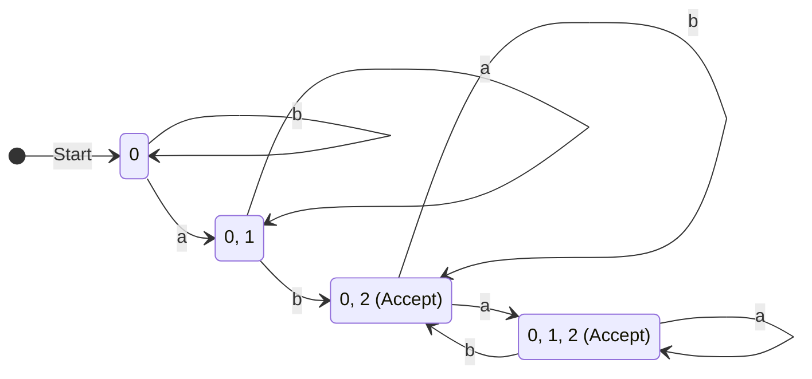
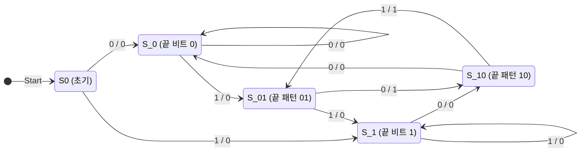

# [이산수학] 중간고사 대비 실전 모의고사 3회

- **시험 시간**: 75분 (15:00 ~ 16:15)
- **총 배점**: 100점 (총 11문제)
- **시험 범위**: 명제 논리와 술어 논리, 증명법, 집합과 함수, 부울 대수 및 카르노 맵, 오토마타(DFA/NFA) 및 유한상태기계(밀리 머신)
- **난이도**: 기출문제 대비 약 15~20% 상향 (최고난도 변별력 문항 및 심화 증명 포함)

---

## [문제지]

### 1. [12점] 다음 명제를 주어진 기호와 논리연산자를 사용하여 그대로 표현하라. (각 3점)

> **\<참고 기호 정의\>**
> - $p$: 인공지능 모델이 과적합(Overfitting)된다.
> - $q$: 검증 손실(Validation loss)이 증가한다.
> - $r$: 조기 종료(Early stopping) 알고리즘이 트리거된다.
> - $s$: 학습률(Learning rate)을 감소시킨다.
> - $U(x)$: $x$는 대학생이다.
> - $C(x)$: $x$는 이산수학을 수강한다.
> - $M(x)$: $x$는 이산수학을 마스터한다.
> - $H(x, y)$: $x$는 $y$에게 이산수학 튜터링을 제공한다.

(1) 인공지능 모델이 과적합되지 않는다면 검증 손실이 증가하지 않을 것이고, 검증 손실이 증가한다면 조기 종료 알고리즘이 트리거되거나 학습률을 감소시킬 것이다.  
(2) 조기 종료 알고리즘이 트리거된다면 학습률을 감소시키지 않을 것이고, 학습률을 감소시키지 않는다면 모델이 과적합될 것이다.  
(3) 어떤 대학생은 이산수학을 수강하지 않고, 이산수학을 수강하는 대학생이라면 모두 이산수학을 마스터한다.  
(4) 이산수학을 수강하면서 마스터한 모든 대학생은 항상 이산수학을 수강하지만 마스터하지 못한 어떤 다른 대학생에게 튜터링을 제공한다.  

---

### 2. [9점] 해당 명제가 항진명제인지, 모순인지, 혹은 불확정명제인지 명시하라. (각 3점, 부분점수 없음)

(1) $((p \rightarrow q) \land \neg q) \rightarrow \neg p$  
(2) $(p \lor q) \land (\neg p \land \neg q)$  
(3) $(p \rightarrow q) \rightarrow (q \rightarrow p)$  

---

### 3. [5점] 다음 두 논리식이 동치인지 판단하라. 그리고 논리적 동치 법칙(양화사의 분배 법칙 및 드 모르간 법칙 등)을 사용하여 그 이유를 수학적으로 엄밀히 증명하라.

$$\exists x (P(x) \rightarrow Q(x)), \quad (\forall x P(x)) \rightarrow (\exists x Q(x))$$

*(단, 전체 집합 정의역은 공집합이 아니라고 가정한다)*

---

### 4. [10점] 다음 문장의 부정을 부정 기호($\neg$)를 사용하지 않고 표현하라. (각 2점, 부분점수 없음)

(1) $\forall x (x^4 + x^2 + 1 > 0)$  
(2) $\exists x (x^3 - 8 = 0)$  
(3) $\forall x ((x \ge 3) \land (x \le 7))$  
(4) $\exists x \exists y ((x + y = 5) \lor (x - y \neq 1))$  
(5) $\forall x \exists y ((xy \ge 0) \rightarrow (x \ge 0 \lor y \ge 0))$  

---

### 5. [10점] 다음 명제가 참인지 거짓인지 판단하라. 그리고 그 이유를 수학적으로 엄밀히 설명하라. (각 5점)

(1) 정수 $n$에 대하여, $n^2 < 0$을 만족하는 정수가 소수(Prime number)라면, $n$은 홀수이다.  
(2) 정수 $n$에 대하여, 만약 $n^2 - 1$이 8의 배수라면, $n$은 홀수이다.  

---

### 6. [9점] 다음 문제를 풀어라. (각 3점, 부분점수 없음)

(1) 집합 $A = \{\emptyset, \{\emptyset, 1\}\}$의 멱집합 $\mathcal{P}(A)$를 구하라.  
(2) 모든 양의 실수 $x$에 대하여 $\lfloor \sqrt{\lfloor x \rfloor} \rfloor = \lfloor \sqrt{x} \rfloor$ 가 항상 성립하는지 판별하고, 성립함을 증명하거나 반례를 제시하라.  
(3) $f(x) = 2x - 5$, $g(x) = 3x + 1$이며, $f, g$가 각각 실수 집합에서 실수 집합으로의 함수일 때, 합성함수 $(f \circ f \circ g)(x)$를 구하라.  

---

### 7. [5점] 임의의 두 부분집합 $A, B$에 대하여 대칭차(Symmetric Difference)의 두 정의 형태인 다음 등식이 성립함을 구성원 표(Membership Table)를 이용해 증명하라. 단, 각 행이 벤 다이어그램 내 어느 영역에 해당하는지 서술하라.

$$(A \cup B) - (A \cap B) = (A - B) \cup (B - A)$$

---

### 8. [10점] 다음 내용이 참인지 거짓인지 판별하고, 참이면 T, 거짓이면 F를 작성하라. (각 2점, 부분점수 없음)

(1) 전체집합이 실수 집합 $\mathbb{R}$일 때, $\exists x \forall y (x \le y^2)$ 는 참이다.  
(2) 두 무리수의 합과 곱이 모두 유리수가 되는 서로 다른 두 무리수가 존재한다.  
(3) 임의의 두 집합 $A, B$에 대하여 항상 $\mathcal{P}(A \cap B) = \mathcal{P}(A) \cap \mathcal{P}(B)$ 가 성립한다.  
(4) 2차원 정수 격자점 전체의 집합 $\mathbb{Z} \times \mathbb{Z}$는 비가산 무한집합이다.  
(5) 실수 집합 $\mathbb{R}$에서 실수 집합 $\mathbb{R}$로의 함수 $f(x) = x^3 - x$는 전단사 함수(일대일 대응)이다.  

---

### 9. [10점] 한 자리의 10진수 자연수(0~9)를 4자리의 2진수 $wxyz$ ($w$ 가중치 8, $x$ 가중치 4, $y$ 가중치 2, $z$ 가중치 1)로 표현한다. 해당 수가 짝수(0, 2, 4, 6, 8)일 때 1을 출력하고, 홀수(1, 3, 5, 7, 9)일 때 0을 출력하도록 하는 가장 간소화된 부울 식을 카르노 맵(무관 조건 10~15 포함)을 이용하여 구하라.

---

### 10. [10점] 다음의 비결정적 유한상태 오토마타 (NFA)를 결정적 유한상태 오토마타 (DFA)로 변환하라. 부분집합 구성 알고리즘의 진행 과정을 명시하고(6점), 최종 DFA를 상태 전이도로 표현하라(4점).

$$M = (S = \{0, 1, 2\}, I = \{a, b\}, f, 0, F = \{2\})$$

**NFA 전이 함수 $f$**:
| 상태 | $a$ | $b$ |
| :---: | :---: | :---: |
| 0 | $\{0, 1\}$ | $\{0\}$ |
| 1 | $\emptyset$ | $\{2\}$ |
| 2 | $\{2\}$ | $\{2\}$ |

---

### 11. [10점] 입력 비트열을 순차적으로 읽으면서, "010" 또는 "101"로 끝날 때마다 1을 출력하고 그렇지 않을 때는 0을 출력하는 밀리 머신(Mealy Machine)을 그림으로 표현하라. 이때 최소한의 상태를 사용하여 표현해야 한다. (부분점수 없음)

---
---

# [정답 및 상세 해설지]

## 1번 정답 및 해설

### (1) 정답: $(\neg p \rightarrow \neg q) \land (q \rightarrow (r \lor s))$
- **해설**: 
  - 절 1: "모델이 과적합되지 않는다면($\neg p$) 검증 손실이 증가하지 않는다($\neg q$)" $\Rightarrow \neg p \rightarrow \neg q$
  - 절 2: "검증 손실이 증가한다면($q$) 조기종료 트리거($r$) 또는 학습률 감소($s$)" $\Rightarrow q \rightarrow (r \lor s)$
  - 두 절을 $\land$로 연결합니다.

### (2) 정답: $(r \rightarrow \neg s) \land (\neg s \rightarrow p)$
- **해설**: 
  - 절 1: $r \rightarrow \neg s$
  - 절 2: $\neg s \rightarrow p$
  - 두 절을 $\land$로 연결합니다.

### (3) 정답: $\exists x (U(x) \land \neg C(x)) \land \forall y ((U(y) \land C(y)) \rightarrow M(y))$
- **해설**: 
  - "어떤 대학생은 이산수학 미수강": $\exists x (U(x) \land \neg C(x))$
  - "이산수학 수강생은 모두 마스터": $\forall y ((U(y) \land C(y)) \rightarrow M(y))$
  - 두 명제를 $\land$로 결합합니다.

### (4) 정답: $\forall x [(U(x) \land C(x) \land M(x)) \rightarrow \exists y (U(y) \land C(y) \land \neg M(y) \land (x \neq y) \land H(x, y))]$
- **해설**: 
  - 전건: 수강하고 마스터한 대학생 $x$ $\Rightarrow U(x) \land C(x) \land M(x)$
  - 후건: $x$와 다른($x \neq y$) 대학생 $y$가 존재하여, $y$는 수강하지만 마스터하지 못했고($C(y) \land \neg M(y)$), $x$가 $y$에게 튜터링을 제공함($H(x, y)$).

---

## 2번 정답 및 해설

### (1) 정답: **항진명제 (Tautology)**
- **해설**: 고전 논리학의 **부정 논법 (Modus Tollens)**입니다.
  - 전건: $(p \rightarrow q) \land \neg q \equiv (\neg p \lor q) \land \neg q \equiv \neg p \land \neg q$.
  - 따라서 전체 식은 $(\neg p \land \neg q) \rightarrow \neg p$.
  - 이는 $A \land B \rightarrow A$ 꼴이므로 항상 참입니다. 따라서 **항진명제**입니다.

### (2) 정답: **모순 (Contradiction)**
- **해설**: 
  - 드 모르간 법칙에 의해 $\neg p \land \neg q \equiv \neg (p \lor q)$ 입니다.
  - $A = p \lor q$라 두면 주어진 식은 $A \land \neg A$가 되어 항상 거짓($F$)입니다.
  - 따라서 **모순**입니다.

### (3) 정답: **불확정명제 (Contingency)**
- **해설**: 
  - $p=F, q=T$일 때:
    - 전건: $F \rightarrow T \equiv T$
    - 후건: $T \rightarrow F \equiv F$
    - 전체식: $T \rightarrow F \equiv \mathbf{F}$
  - $p=T, q=T$일 때:
    - 전건: $T \rightarrow T \equiv T$
    - 후건: $T \rightarrow T \equiv T$
    - 전체식: $T \rightarrow T \equiv \mathbf{T}$
  - 참과 거짓이 모두 가능하므로 **불확정명제**입니다.

---

## 3번 정답 및 해설

### **정답**: **동치이다.**
### **이유 (증명)**:
좌변 $\exists x (P(x) \rightarrow Q(x))$를 단계별 동치 법칙으로 변형합니다:
1. **조건문의 정의 ($A \rightarrow B \equiv \neg A \lor B$)**:
   $$\exists x (P(x) \rightarrow Q(x)) \equiv \exists x (\neg P(x) \lor Q(x))$$
2. **존재양화사의 논리합($\lor$) 분배 법칙**:
   $$\exists x (\neg P(x) \lor Q(x)) \equiv (\exists x \neg P(x)) \lor (\exists x Q(x))$$
3. **양화사의 부정 법칙 ($\exists x \neg P(x) \equiv \neg \forall x P(x)$)**:
   $$(\exists x \neg P(x)) \lor (\exists x Q(x)) \equiv \neg(\forall x P(x)) \lor (\exists x Q(x))$$
4. **조건문의 정의 역적용 ($\neg A \lor B \equiv A \rightarrow B$)**:
   $$\neg(\forall x P(x)) \lor (\exists x Q(x)) \equiv (\forall x P(x)) \rightarrow (\exists x Q(x))$$
따라서 좌변은 우변과 정확히 동치입니다.

---

## 4번 정답 및 해설

(1) $\neg \forall x (x^4 + x^2 + 1 > 0) \equiv$ **$\exists x (x^4 + x^2 + 1 \le 0)$**  
(2) $\neg \exists x (x^3 - 8 = 0) \equiv$ **$\forall x (x^3 - 8 \neq 0)$**  
(3) $\neg \forall x ((x \ge 3) \land (x \le 7)) \equiv$ **$\exists x ((x < 3) \lor (x > 7))$**  
(4) $\neg \exists x \exists y ((x + y = 5) \lor (x - y \neq 1)) \equiv$ **$\forall x \forall y ((x + y \neq 5) \land (x - y = 1))$**  
(5) $\neg \forall x \exists y ((xy \ge 0) \rightarrow (x \ge 0 \lor y \ge 0)) \equiv$ **$\exists x \forall y ((xy \ge 0) \land (x < 0 \land y < 0))$**  
*(조건문 부정: $\neg(A \to (B \lor C)) \equiv A \land \neg B \land \neg C$)*

---

## 5번 정답 및 해설

### (1) 정답: **참 (True)**
- **이유**:
  - 임의의 정수 $n$에 대하여 $n^2 \ge 0$이므로, $n^2 < 0$을 만족하는 정수는 존재하지 않습니다.
  - 따라서 조건문의 가정인 "$n^2 < 0$을 만족하는 정수가 소수이다"는 항상 **거짓(False)**입니다.
  - 조건문 $p \rightarrow q$는 가정이 거짓일 때 결론의 진위와 무관하게 항상 참이 되므로(**공허한 참, Vacuous Truth**), 주어진 명제는 참입니다.

### (2) 정답: **참 (True)**
- **이유 (대우증명법)**:
  - 원래 명제: "$n^2 - 1$이 8의 배수이면 $n$은 홀수이다."
  - **대우 명제**: "$n$이 짝수이면, $n^2 - 1$은 8의 배수가 아니다."
  - $n$이 짝수라고 가정하면, 어떤 정수 $k$에 대하여 $n = 2k$로 표현할 수 있습니다.
  - $n^2 - 1$을 계산하면:
    $$n^2 - 1 = (2k)^2 - 1 = 4k^2 - 1 = 2(2k^2 - 1) + 1$$
  - $n^2 - 1$은 2로 나눈 나머지가 1인 **홀수**입니다.
  - 8의 배수는 항상 짝수이므로, 홀수인 $n^2 - 1$은 절대로 8의 배수가 될 수 없습니다.
  - 따라서 대우 명제가 참이므로 동치인 원래 명제도 참입니다.

---

## 6번 정답 및 해설

### (1) 정답:
$$\mathcal{P}(A) = \{\emptyset, \{\emptyset\}, \{\{\emptyset, 1\}\}, \{\emptyset, \{\emptyset, 1\}\}\}$$
- **해설**: 집합 $A$의 원소는 $\emptyset$과 $\{\emptyset, 1\}$의 2개이므로 멱집합의 원소는 $2^2 = 4$개입니다.

### (2) 정답: **성립한다 (참).**
- **해설 (증명)**:
  - $m = \lfloor \sqrt{x} \rfloor$ 라고 두자. 바닥함수의 정의에 의해 $m$은 정수이고 다음이 성립한다:
    $$m \le \sqrt{x} < m + 1$$
  - 양변을 제곱하면 (양의 실수이므로):
    $$m^2 \le x < (m + 1)^2$$
  - $m^2$과 $(m+1)^2$은 모두 정수이므로, $x$에 바닥함수를 취해도 정수 부등호가 유지된다:
    $$m^2 \le \lfloor x \rfloor < (m + 1)^2$$
  - 다시 양의 제곱근을 취하면:
    $$m \le \sqrt{\lfloor x \rfloor} < m + 1$$
  - 따라서 $\sqrt{\lfloor x \rfloor}$의 바닥함수 값은 정확히 $m$이다:
    $$\lfloor \sqrt{\lfloor x \rfloor} \rfloor = m = \lfloor \sqrt{x} \rfloor$$
  - 증명 완료.

### (3) 정답: **$(f \circ f \circ g)(x) = 12x - 11$**
- **해설**:
  1. $g(x) = 3x + 1$
  2. $(f \circ g)(x) = f(3x + 1) = 2(3x + 1) - 5 = 6x + 2 - 5 = 6x - 3$
  3. $(f \circ f \circ g)(x) = f(6x - 3) = 2(6x - 3) - 5 = 12x - 6 - 5 = 12x - 11$.

---

## 7번 정답 및 해설

### **구성원 표 (Membership Table)**

| $A$ | $B$ | 벤 다이어그램 영역 설명 | $A \cup B$ | $A \cap B$ | 좌변: $(A \cup B) - (A \cap B)$ | $A - B$ | $B - A$ | 우변: $(A - B) \cup (B - A)$ |
| :---: | :---: | :---: | :---: | :---: | :---: | :---: | :---: | :---: |
| 1 | 1 | $A$와 $B$의 교집합 | 1 | 1 | **0** | 0 | 0 | **0** |
| 1 | 0 | $A$에만 속하는 순수 $A$ | 1 | 0 | **1** | 1 | 0 | **1** |
| 0 | 1 | $B$에만 속하는 순수 $B$ | 1 | 0 | **1** | 0 | 1 | **1** |
| 0 | 0 | 두 집합 바깥 영역 | 0 | 0 | **0** | 0 | 0 | **0** |

- **결론**: 좌변과 우변의 열이 모든 영역에서 $(0, 1, 1, 0)$으로 일치합니다.
- 순수 $A$ 영역과 순수 $B$ 영역에 속하는 원소들만 포함되므로 등식이 증명됩니다.

---

## 8번 정답 및 해설

(1) **T**: $x = 0$ (또는 임의의 음수)를 택하면, 모든 실수 $y$에 대해 $y^2 \ge 0$이므로 $0 \le y^2$이 항상 성립합니다.  
(2) **T**: $a = 1 + \sqrt{2}$, $b = 1 - \sqrt{2}$ (둘 다 무리수).
  - 합: $a + b = 2$ (유리수)
  - 곱: $ab = 1 - 2 = -1$ (유리수). 따라서 존재합니다.  
(3) **T**: $X \in \mathcal{P}(A \cap B) \iff X \subseteq (A \cap B) \iff X \subseteq A \land X \subseteq B \iff X \in \mathcal{P}(A) \land X \in \mathcal{P}(B) \iff X \in \mathcal{P}(A) \cap \mathcal{P}(B)$ 이므로 항상 성립합니다.  
(4) **F**: 가산무한집합들의 데카르트 곱 $\mathbb{Z} \times \mathbb{Z}$는 여전히 셀 수 있는 **가산무한집합**(기수 $\aleph_0$)입니다.  
(5) **F**: $f(x) = x(x-1)(x+1)$에서 $f(-1) = f(0) = f(1) = 0$이므로 서로 다른 입력이 같은 출력을 갖습니다. 즉 단사(일대일) 함수가 아니므로 전단사 함수가 아닙니다.

---

## 9번 정답 및 해설

### **정답: $\overline{z}$**

#### **상세 풀이**
- 10진수 0~9 중 짝수: 0, 2, 4, 6, 8 $\Rightarrow$ 최소항 $m(0, 2, 4, 6, 8)$ 출력 1
- 홀수: 1, 3, 5, 7, 9 $\Rightarrow$ 최소항 $m(1, 3, 5, 7, 9)$ 출력 0
- Don't-Care 항: $d(10, 11, 12, 13, 14, 15)$

**카르노 맵 ($wx$ 행, $yz$ 열)**:
| $wx \backslash yz$ | 00 | 01 | 11 | 10 |
| :---: | :---: | :---: | :---: | :---: |
| **00** | **1** (0) | 0 (1) | 0 (3) | **1** (2) |
| **01** | **1** (4) | 0 (5) | 0 (7) | **1** (6) |
| **11** | $X$ (12) | $X$ (13) | $X$ (15) | $X$ (14) |
| **10** | **1** (8) | 0 (9) | $X$ (11) | $X$ (10) |

**묶음 분석**:
- 첫 번째 열 ($yz = 00$ 전체 4개 셀: 0, 4, 12, 8) $\rightarrow$ 모두 1과 $X$
- 네 번째 열 ($yz = 10$ 전체 4개 셀: 2, 6, 14, 10) $\rightarrow$ 모두 1과 $X$
- 카르노 맵의 좌우 끝 열인 $yz = 00$과 $yz = 10$은 서로 인접하므로 8개 크기의 직사각형으로 하나로 묶을 수 있습니다!
- 이 8개 묶음에서 공통 변수는 **$z = 0$**입니다.
- 따라서 가장 간소화된 부울 식은 단 하나의 리터럴인:
  $$F = \overline{z}$$
*(직관적 검증: 2진수에서 짝수란 최하위 비트 $z$가 0인 수와 정확히 동치입니다!)*

---

## 10번 정답 및 해설

### **1. 부분집합 구성 알고리즘 진행 과정 (6점)**
1. **시작 상태**: $\{0\}$
2. $\{0\}$ 전이:
   - 입력 $a$: $f(0, a) = \{0, 1\}$ (신규)
   - 입력 $b$: $f(0, b) = \{0\}$
3. $\{0, 1\}$ 전이:
   - 입력 $a$: $f(0, a) \cup f(1, a) = \{0, 1\} \cup \emptyset = \{0, 1\}$
   - 입력 $b$: $f(0, b) \cup f(1, b) = \{0\} \cup \{2\} = \{0, 2\}$ (신규)
4. $\{0, 2\}$ 전이:
   - 입력 $a$: $f(0, a) \cup f(2, a) = \{0, 1\} \cup \{2\} = \{0, 1, 2\}$ (신규)
   - 입력 $b$: $f(0, b) \cup f(2, b) = \{0\} \cup \{2\} = \{0, 2\}$
5. $\{0, 1, 2\}$ 전이:
   - 입력 $a$: $\{0, 1\} \cup \emptyset \cup \{2\} = \{0, 1, 2\}$
   - 입력 $b$: $\{0\} \cup \{2\} \cup \{2\} = \{0, 2\}$
6. 탐색 완료.

- **수락 상태**: $F = \{2\}$를 포함하는 상태:
  $$\mathbf{\{0, 2\}, \{0, 1, 2\}}$$

### **2. DFA 상태 전이도 (4점)**

---

## 11번 정답 및 해설

### **정답: 최소 5개 상태 밀리 머신**

"010" 또는 "101" 시퀀스를 동시에 검출하는 밀리 머신입니다.
- **$S_0$**: 초기 상태 (아무 접두사도 일치하지 않음)
- **$S_0'$ (상태 0)**: 직전 1개 비트가 "0"인 상태
- **$S_1'$ (상태 1)**: 직전 1개 비트가 "1"인 상태
- **$S_{01}$ (상태 01)**: 직전 2개 비트가 "01"인 상태 (다음 0 입력 시 "010" 완성)
- **$S_{10}$ (상태 10)**: 직전 2개 비트가 "10"인 상태 (다음 1 입력 시 "101" 완성)

#### **전이 및 출력 규칙**
1. **$S_0$ (시작)**:
   - 입력 0 $\to$ 출력 0, $S_0'$로 이동
   - 입력 1 $\to$ 출력 0, $S_1'$로 이동
2. **$S_0'$ (마지막: 0)**:
   - 입력 0 $\to$ 출력 0, $S_0'$ 유지
   - 입력 1 $\to$ 출력 0 ("01" 형성), $S_{01}$로 이동
3. **$S_1'$ (마지막: 1)**:
   - 입력 0 $\to$ 출력 0 ("10" 형성), $S_{10}$로 이동
   - 입력 1 $\to$ 출력 0, $S_1'$ 유지
4. **$S_{01}$ (마지막: 01)**:
   - 입력 0 $\to$ **출력 1** ("010" 검출!), 다음 상태는 마지막 2비트가 "10"이 되므로 **$S_{10}$**으로 이동 ($0/1$)
   - 입력 1 $\to$ 출력 0 ("011"의 끝은 1), $S_1'$로 이동 ($1/0$)
5. **$S_{10}$ (마지막: 10)**:
   - 입력 0 $\to$ 출력 0 ("100"의 끝은 0), $S_0'$로 이동 ($0/0$)
   - 입력 1 $\to$ **출력 1** ("101" 검출!), 다음 상태는 마지막 2비트가 "01"이 되므로 **$S_{01}$**으로 이동 ($1/1$)

